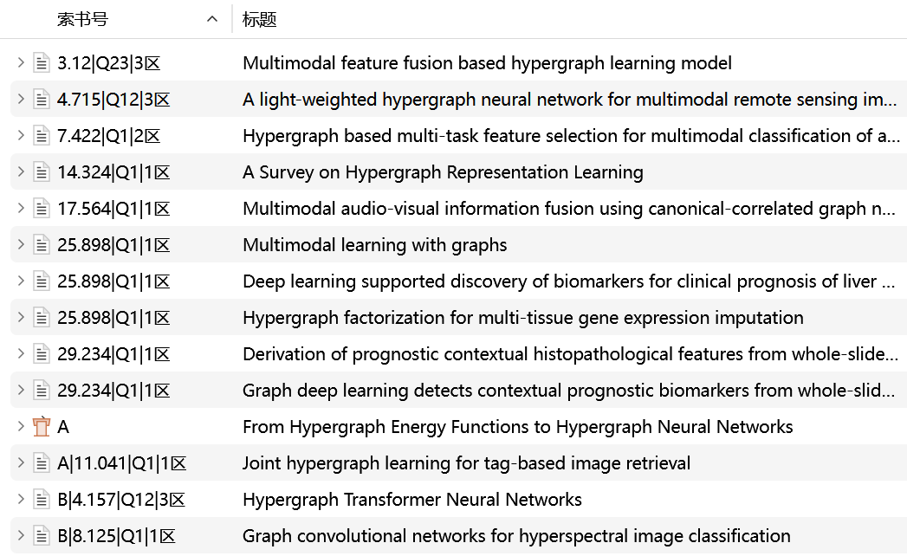

# Zotero 10 Scholar Rank · CCF / JCR / 中科院分区

为 Zotero 10 提供元数据整理、DOI 信息更新和学术分区显示。内置 CCF、JCR 和中科院指标表，在索书号中展示 `A|20.4|Q1|1区TOP`；缺失指标直接省略，例如只显示 `C`。

**3.1.2 重构：统一为三个操作，自动处理与手动更新分别设置。**

## 功能

| 操作 | 功能 |
| --- | --- |
| **整理元数据** | 整理标题空白、DOI、页码、卷期，补全空语言和期刊缩写。 |
| **根据 DOI 更新** | 手动联网查询题目、作者、期刊等信息，返回的字段直接覆盖旧值。 |
| **更新分区指标** | 更新 CCF、影响因子、JCR 和中科院大类分区/TOP，直接写入索书号。 |

## 安装与使用

1. 在 Zotero **工具 → 插件 → 从文件安装插件** 中选择 `.xpi` 文件，无需解压。
2. 在文献列表显示“索书号”列，选中文献，右键 **Scholar Rank** 执行相应操作。
3. 在 **工具 → Scholar Rank 设置** 中开启自动整理或自动更新指标，也可调整规则、更新数据表。

自动开关默认关闭，仅处理新增条目，自动分区更新只填空索书号；**根据 DOI 更新始终只能手动执行**。查询失败或指标未匹配时保留原值，支持 Zotero 原生撤销。

中科院使用 **2025 升级版大类分区**，不使用新锐分区；指标年份可在设置中查看。

与 **Linter / Format Metadata** 共存时，请关闭其“清理被滥用的标准字段”，避免索书号指标被清空。

## 界面




## 开发

Node.js 22+、Python 3.10+。

```sh
node --test tests/core.test.cjs tests/metadata.test.cjs tests/plugin.test.cjs
python -m unittest discover -s tests -p "test_*.py"
python scripts/build.py
```

构建前按[数据准备](data/README.md)放置指标表。
[使用说明](docs/INSTALL.md) · [开发说明](docs/DEVELOPMENT.md) · [修改记录](CHANGELOG.md)

## 许可与致谢

软件采用 [MIT](LICENSE)。感谢 [Zotero-Scholar-Rank](https://github.com/SiriusXT/Zotero-Scholar-Rank)、[Linter](https://github.com/northword/zotero-format-metadata) 和 [ShowJCR](https://github.com/hitfyd/ShowJCR) 提供设计与数据格式参考，详见 [NOTICE](NOTICE.md)。

维护：**hanxiangmin** · 开发协助：**OpenAI Codex**。
