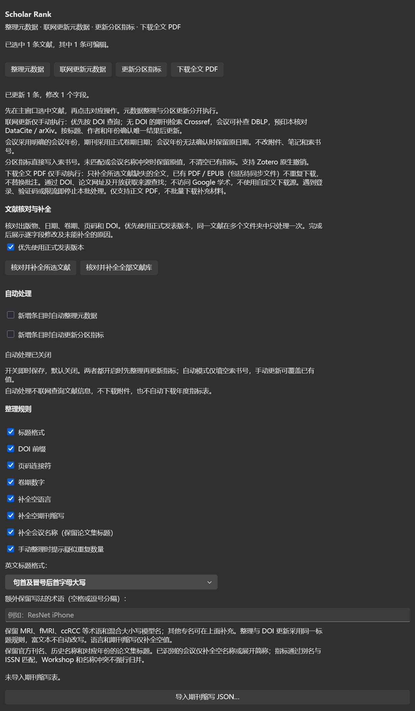

# Zotero 10 Scholar Rank · CCF / JCR / 中科院分区

为 Zotero 10 提供元数据整理、全库文献核对、正式版本查找、学术分区显示和手动全文下载。内置 CCF、JCR 和中科院指标表，在索书号中展示 `A|20.4|Q1|1区TOP`；缺失指标直接省略，例如只显示 `C`。

[下载安装包](https://github.com/hanxiangmin/zotero10-scholar/releases/latest) · [版本更新](CHANGELOG.md)

## 功能

| 操作 | 功能 |
| --- | --- |
| **整理元数据** | 英文标题句首和冒号后首字母大写，统一会议名称，整理 DOI、页码、卷期，补全空语言和期刊缩写。 |
| **联网更新元数据** | 优先按 DOI 查询；无 DOI 时按标题、作者和出版信息检索 Crossref，会议可补查 DBLP，预印本核对 DataCite / arXiv。会议按会议年，期刊按正式卷期日期。 |
| **更新分区指标** | 更新 CCF、影响因子、JCR 和中科院大类分区/TOP，直接写入索书号。 |
| **下载全文 PDF** | 手动补全所选文献缺失的正文 PDF，跳过已有全文，下载后展示逐项结果。 |

## 安装与使用

1. 在 Zotero **工具 → 插件 → 从文件安装插件** 中选择 `.xpi` 文件，无需解压。
2. 在文献列表显示“索书号”列，选中文献，右键 **Scholar Rank** 执行相应操作。
3. 在 **工具 → Scholar Rank 设置** 中开启自动整理或自动更新指标，也可调整规则、更新数据表。

自动开关默认关闭，仅处理新增条目，自动分区更新只填空索书号；**联网更新元数据始终只能手动执行**。支持 Zotero 原生撤销。

会议论文可使用无 DOI 的正式会议记录补全名称和年份。NeurIPS 兼容 `Advances in Neural Information Processing Systems 34` 等论文集写法，CCF 等级为 `A`。先执行“联网更新元数据”，再执行“更新分区指标”。预印本可更新自己的标题、作者、年份与 DOI。

**附件下载也仅手动执行**，不会随导入或元数据更新启动。通过 DOI、论文网址与开放获取来源查找正文 PDF，不访问 Google 学术、不使用自定义下载源；已有 PDF / EPUB、批注和笔记不替换。下载排队执行，遇到登录、验证码或限流就停止并提示；可在设置页停止下载。需要机构权限或仅支持浏览器下载的论文，请使用浏览器和 Zotero Connector 保存。

每次更新后弹出结果窗口，按文献逐项展示 **字段、修改前、修改后**。自动更新共用一个结果窗口；没有变化或未能更新时显示原因。

标题保留 `ccRCC`、`fMRI` 等专业写法，可在设置中补充术语或保留原大小写。会议年份缺少可靠记录时不覆盖日期。
保留官方刊名和对应年份的论文集标题，会议名称仅补全空值或展开简称。指标通过名称别名、历史名称和 ISSN 对应目录，不要求出版名称与指标表文字完全一致；Workshop 与历史分刊分别识别。[名称处理规则](docs/VENUE_NAMES.md)

中科院使用 **2025 升级版大类分区**，不使用新锐分区；指标年份可在设置中查看。
分区未匹配或会议信息冲突时保留原值，不清空已有指标。

与 **Linter / Format Metadata** 共存时，请关闭其“清理被滥用的标准字段”，避免索书号指标被清空。

## 全库核对与正式版本

打开 **工具 → Scholar Rank 设置 → 文献核对与补全**，选择核对所选文献或全部文献库。

核对出版物、年份、卷次、期号、页码和 DOI。有 DOI 时先核对登记记录，未找到可信结果时按题目和作者继续检索。默认优先正式发表版本，支持通过 arXiv 关联的正式 DOI 查找改名后的论文。匹配明确后直接更新原条目，结果窗口列出修改前后内容和未能补全的原因。

全库操作覆盖各文件夹与未分类条目，同一文献只处理一次。可在设置页停止核对，已完成的修改会保留。

## 界面

### 索书号指标


### 自动处理与整理规则



### 修改前后对照


## 开发

Node.js 22+、Python 3.10+。

```sh
node --test tests/core.test.cjs tests/metadata.test.cjs tests/plugin.test.cjs
python -m unittest discover -s tests -p "test_*.py"
python scripts/build.py
```

构建前按[数据准备](data/README.md)放置指标表。
[使用说明](docs/INSTALL.md) · [开发说明](docs/DEVELOPMENT.md) · [修改记录](CHANGELOG.md)

## 许可与致谢

软件采用 [MIT](LICENSE)。感谢 [Zotero-Scholar-Rank](https://github.com/SiriusXT/Zotero-Scholar-Rank)、[Linter](https://github.com/northword/zotero-format-metadata) 和 [ShowJCR](https://github.com/hitfyd/ShowJCR) 提供设计与数据格式参考，详见 [NOTICE](NOTICE.md)。

维护：**hanxiangmin** · 开发协助：**OpenAI Codex**。
